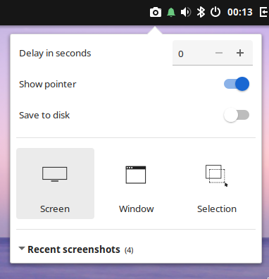

# Budgie Screenshot Applet (Wayland)

A panel applet for Budgie 10.10+ that takes screenshots of a monitor, a window or a selection. It's a remake of the classic [budgie-screenshot-applet](https://github.com/cybre/budgie-screenshot-applet) for Budgie's Wayland session.



## Features

* **Screen**, **Window** (pick from a list) and **Selection** capture
* Delay, show-pointer and save-to-disk options at the top of the popover
* Copies to the clipboard; saving to disk is optional
* Collapsible list of recent screenshots with copy, edit, show-in-folder and delete
* Countdown and a random face on the panel icon, optional screen flash and shutter sound
* Choice of classic or Budgie Screenshot style icons
* Middle-click the panel icon for a quick selection capture
* Translations: German, French, Polish, Spanish

## Requirements

* Budgie 10.10 or newer (Wayland session)
* `grim`, `slurp`, `wl-clipboard`
* Window capture needs grim 1.5+ and a compositor that supports toplevel capture (recent labwc)
* Optional: `satty` or `swappy` for editing, `canberra-gtk-play` for the shutter sound

## Building

Build dependencies: `meson`, `vala`, and the development files for `budgie-3.0`, `libpeas-2`, `gtk+-3.0`, `gtk-layer-shell-0` and `wayland-client`.

```sh
meson setup build --prefix=/usr
ninja -C build
sudo ninja -C build install
budgie-panel --replace &disown
```

Then add **Screenshot** in *Budgie Desktop Settings → Panel → +*.

### Solus package

```sh
sudo eopkg it solbuild && sudo solbuild init    # one time
./packaging/make-eopkg.sh
sudo eopkg it dist/budgie-screenshot-applet-wl-*.eopkg
```

## Translating

The applet uses your system language automatically.

To add a language, copy `po/budgie-screenshot-applet-wl.pot` to `po/<lang>.po`, translate it, add the language code to `po/LINGUAS` and open a pull request.
To refresh the template after changing strings, run `ninja -C build budgie-screenshot-applet-wl-pot`.

## License

GPL-2.0-or-later. See [LICENSE](LICENSE).

Credits:
* Classic mode icons and the panel face idea: [budgie-screenshot-applet](https://github.com/cybre/budgie-screenshot-applet) by Stefan Ric
* Budgie-style mode icons: [Budgie Desktop](https://github.com/BuddiesOfBudgie/budgie-desktop)'s screenshot tool
* `ext-foreign-toplevel-list-v1.xml`: wayland-protocols (MIT)
